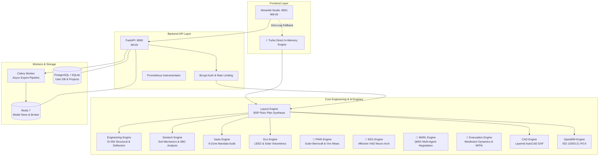

<div align="center">

# 🏗️ BuildMetrics AI
### Autonomous AI-Powered Architectural CAD, Structural Engineering & OpenBIM Studio (v2.0.0)

[](https://www.python.org)
[](https://streamlit.io)
[](https://github.com/shambhushekharsinha-engg/BuildMetrics-AI)
[](https://fastapi.tiangolo.com)
[](https://threejs.org)
[](https://www.autodesk.com)
[](https://www.buildingsmart.org)
[](https://postgresql.org)
[](https://redis.io)
[](https://docs.celeryq.dev)
[](https://docker.com)
[](LICENSE)
[](https://github.com/shambhushekharsinha-engg/BuildMetrics-AI/actions)

*Transform a single natural-language text prompt into production-ready 2D CAD blueprints, interactive 3D WebGL scenes, OpenBIM IFC models, IS 456 structural schedules, geotechnical foundation designs, Vastu spatial audits, and CSI MasterFormat cost estimates in seconds.*

[Quick Start](#-quick-start) · [AWS Hosting](AWS_DEPLOYMENT_GUIDE.md) · [Features](#-core-features) · [CAD & BIM](#-cad--openbim-interoperability) · [Architecture](#-system-architecture) · [API Endpoints](#-api-endpoints) · [Testing](#-running-tests)

</div>

---

## 🌟 Core Features

BuildMetrics AI integrates architectural layout synthesis, civil structural mechanics, geotechnical engineering, ancient spatial harmony (Vastu Shastra), environmental sustainability, and financial quantity takeoff into a unified engineering platform.

| Domain | Capabilities |
| :--- | :--- |
| **🤖 Autonomous AI Design** | Natural language prompt synthesis (Gemini 2.5 Flash), conversational architectural redesign, real-time diff tracking, and prompt undo/revision history (last 5 designs). |
| **🔬 PINN Structural AI** | Physics-Informed Neural Network engine modeling continuous Euler-Bernoulli deflection, Von Mises yield stress, Fourier positional encodings ($L=6$), and Factor of Safety ($FS$) classification. |
| **🧠 EEG Neuro-Architecture** | Affective cognitive design computing per-room EEG spectral band powers ($\alpha, \beta, \theta, \gamma$), 3D Valence-Arousal-Dominance (VAD) emotional states, and biophilic architectural remedies. |
| **🤖 MARL Agent Negotiation** | Multi-Agent Reinforcement Learning with QMIX monotonic value factorisation balancing 4 competing roles: *Architect*, *Structural Engineer*, *MEP Specialist*, and *Eco-Auditor*. |
| **🚪 Evacuation & Crowd Safety** | Continuous Weidmann crowd flow dynamics ($v(k) = v_0[1 - e^{-\gamma(1/k - 1/k_{jam})}]$), 8×8 density heatmaps, and NFPA 101 Life Safety Code travel distance audits. |
| **📐 2D CAD Blueprint Studio** | CAD-grade ISO 128 vector floor plans across 6 themes with wall diagonal hatching, door swing clearance arcs, window mullion centerlines, multi-tier bay dimension chains, title block metadata, and furniture symbols. |
| **🏗️ 3D WebGL Visualizer** | High-performance Three.js viewer with color-coded floor fills, physical glass balcony railings, pitched roof trusses, swimming pool rendering, and a floating Quick-Action Bar (`🔄 Orbit`, `📐 2D Top`, `🏢 Front Elevation`, `🚶 Walkthrough`, `🏠 Roof Toggle`, `☀️ Day/Night Cycle`, `📸 HD Snapshot`). |
| **🏢 OpenBIM & CAD Interoperability** | **Native AutoCAD DXF (`.dxf`)** ASCII export and **Industry-Standard OpenBIM IFC4 (`.ifc`)** generation compatible with Autodesk Revit, ArchiCAD, Solibri, FreeCAD, and Blender. |
| **🧱 IS 456 / ACI 318 Structural Mechanics** | Column axial tributary service load accumulation ($P_u$), structural safety factors ($FS$), column & beam rebar schedules, design bending moment ($M_u = \frac{w_u L^2}{8}$), and serviceability deflection checks ($L/250$). |
| **🌍 Geotechnical & Soil Engineering** | 5 regional soil profiles (*Hard Rock*, *Medium Sand*, *Stiff Clay*, *Black Cotton Expansive Soil*, *Soft Marine Clay*), Safe Bearing Capacity (SBC in kPa), footing base contact area, foundation depth, excavation bulk volumetrics ($m^3$), and IS 1893 seismic hazard detailing (Zone II to Zone V). |
| **🧭 Vastu Shastra & Spatial Harmony** | 9-sector *Vastu Purusha Mandala* orientation audit ($0\text{–}100$ score, $A+/A/B/C$ auspicious grade), 5-element (*Pancha Bhoota*) balance index (Water, Fire, Earth, Air, Space), *Brahmasthan* core clearance verification, and remedial advice. |
| **💰 Dynamic BOQ & Multi-Currency** | CSI MasterFormat 2016 division mapping with interactive live sliders for material rates (Steel, Concrete, Masonry, Glass, Flooring, MEP, Labor). Live currency switcher supporting **USD (\$)**, **INR (₹)**, **EUR (€)**, **GBP (£)**, **AED (د.إ)**, **CAD (CA\$)**, and **AUD (AU\$)**. |
| **🌱 Eco & LEED Sustainability** | Formula-driven rooftop solar PV generation potential (kWh/mo), rainwater harvesting cistern sizing, embodied carbon emissions ($tCO_2e$), and LEED certification rating (Certified, Silver, Gold, Platinum). |
| **🌦️ Meteorological Risk Management** | Predictive construction timeline modeling calibrated against 6 global climate zones (*Tropical Monsoon*, *Arid Desert*, *Temperate*, *Cold Continental*, *Mediterranean*, *Tropical Humid*). |
| **⚡ Turbo Direct Engine** | Seamless 0ms in-memory fallback engine that ensures 100% platform availability even when remote microservices or cloud workers are cold or unreachable. |

---

## 📐 CAD & OpenBIM Interoperability

BuildMetrics AI exports directly to standard industry vector and BIM formats without requiring proprietary desktop CAD software:

```
                  ┌────────────────────────────────────────┐
                  │          BuildMetrics AI Core          │
                  │        Generative BIM & CAD            │
                  └──────────────────┬─────────────────────┘
                                     │
         ┌───────────────────────────┼───────────────────────────┐
         ▼                           ▼                           ▼
┌──────────────────┐       ┌──────────────────┐        ┌──────────────────┐
│   AutoCAD DXF    │       │   OpenBIM IFC4   │        │ 3D Mesh & Vector │
│   (.dxf ASCII)   │       │ (.ifc ISO-10303) │        │ (OBJ, SVG, PDF)  │
└────────┬─────────┘       └────────┬─────────┘        └────────┬─────────┘
         │                          │                           │
         ▼                          ▼                           ▼
AutoCAD, LibreCAD,         Autodesk Revit, ArchiCAD,   WebGL Three.js, SketchUp,
Vectorworks, CorelCAD      Solibri, BlenderBIM, FreeCAD  High-Resolution Plotters
```

- **AutoCAD DXF (Drawing Exchange Format):** Layered R12/2000 ASCII CAD standard with designated layers:
  - `A-WALL-EXT`: Exterior boundary walls (0.35mm lineweight)
  - `A-WALL-INT`: Interior partition walls (0.20mm lineweight)
  - `A-COLS`: Structural reinforced concrete columns (0.50mm lineweight)
  - `A-BEAM`: Structural grid beams (dashed lines)
  - `A-DOOR` & `A-WIND`: Door openings with swing arcs and window glazing
  - `A-ROMS` & `A-DIMS`: Room text labels with metric areas and plot boundary dimensions
- **OpenBIM IFC4 (ISO 10303-21 STEP):** True semantic building information modeling containing `IfcProject`, `IfcSite`, `IfcBuilding`, `IfcBuildingStorey`, `IfcWallStandardCase`, `IfcColumn`, `IfcBeam`, `IfcSlab`, and `IfcSpace`.

---

## ⚡ Quick Start

### 1. Docker Compose (Full Stack Recommended)

> **Prerequisites**: [Docker Desktop](https://www.docker.com/) installed.

```bash
# 1. Clone repository
git clone https://github.com/shambhushekharsinha-engg/BuildMetrics-AI.git
cd BuildMetrics-AI

# 2. Configure environment
cp .env.example .env
# Add your GEMINI_API_KEY to .env

# 3. Spin up full microservice cluster
docker compose up --build -d

# 4. Access the platforms
#    Streamlit UI:     http://localhost:8501
#    FastAPI Swagger:  http://localhost:8000/docs
#    Prometheus:       http://localhost:9090
#    Grafana:          http://localhost:3000
```

### 2. Local Bare-Metal Development

```bash
# Install pinned production dependencies
pip install -r requirements.txt

# Configure environment variables
export GEMINI_API_KEY="your-api-key"
export DATABASE_URL="sqlite:///buildmetrics.db"
export API_BASE_URL="http://localhost:8000"

# Terminal 1 — FastAPI Backend
uvicorn api:app --host 0.0.0.0 --port 8000 --reload

# Terminal 2 — Streamlit Frontend Studio
streamlit run app.py --server.port 8501

# Terminal 3 — Celery Background Worker (Optional)
celery -A worker.celery_app worker --loglevel=info
```

### 3. Amazon AWS Cloud Deployment (Production)

Deploy the complete container stack to Amazon AWS using our pre-built CloudFormation template or App Runner config:

* ☁️ **1-Click AWS CloudFormation**: Launch an EC2 stack with security groups, Docker Compose, and automated auto-restart via [`aws/cloudformation.yml`](aws/cloudformation.yml).
* 🌐 **AWS App Runner (Serverless HTTPS)**: Deploy a zero-maintenance container service via [`aws/apprunner.yaml`](aws/apprunner.yaml).
* 📜 **Step-by-Step Walkthrough**: Read our complete [**AWS Deployment Guide**](AWS_DEPLOYMENT_GUIDE.md).

---

## 🏛️ System Architecture



---

## 🔌 API Endpoints

All endpoints are self-documenting and interactive via Swagger UI at `/docs`.

| Method | Endpoint | Description |
| :--- | :--- | :--- |
| `GET` | `/healthz` | Kubernetes/Docker container liveness probe |
| `GET` | `/api/v1/version` | Active service version, Git SHA, and deployment environment |
| `POST` | `/api/v1/generate` | Generates a complete `BuildingModel` from a natural-language prompt |
| `POST` | `/api/v1/render/2d` | Renders a high-resolution 2D CAD blueprint PNG |
| `POST` | `/api/v1/render/3d` | Generates interactive Three.js WebGL HTML viewport |
| `POST` | `/api/v1/export` | Synchronous export (`png`, `svg`, `pdf`, `dxf`, `ifc`, `obj`, `gltf`, `bundle`) |
| `POST` | `/api/v1/export/async` | Queues async background export task via Celery |
| `GET` | `/api/v1/export/status/{id}`| Polls Celery background export task status |
| `GET` | `/api/v1/download` | Streams generated CAD/BIM archive to client |
| `GET` | `/metrics` | Prometheus metrics scrape endpoint (`ops`) |

---

## 🧪 Running Tests

The test suite includes unit, integration, civil mechanics, CAD, and smoke tests:

```bash
# Run the complete test suite
pytest tests/ -v

# Run with coverage reporting
pytest --cov=build_matrix --cov=api --cov=cost_engine

# Run specific CAD & BIM test suites
pytest tests/test_dxf_geotech_vastu.py tests/test_ifc.py -v

# Strict code quality check
ruff check .
```

---

## 📋 Comprehensive Changelog

### v2.0.0 — Cognitive AI, Neuro-Architecture & CAD/3D Overhaul (October 2026)
* 🔬 **PINN Structural Mechanics Engine:** Implemented [`build_matrix/pinn_structural.py`](build_matrix/pinn_structural.py) modeling continuous Euler-Bernoulli deflection, Von Mises yield stress, Fourier positional encodings ($L=6$), and Factor of Safety ($FS$) classification.
* 🧠 **EEG Affective Neuro-Architecture:** Added [`build_matrix/eeg_affective.py`](build_matrix/eeg_affective.py) computing per-room EEG spectral band powers ($\alpha, \beta, \theta, \gamma$), 3D Valence-Arousal-Dominance (VAD) emotional states, and biophilic architectural recommendations.
* 🤖 **MARL QMIX Architectural Negotiation:** Added [`build_matrix/marl_architectural.py`](build_matrix/marl_architectural.py) coordinating 4 autonomous engineering agents (*Architect*, *Structural*, *MEP*, *Eco*) with monotonic joint utility factorisation.
* 🚪 **Weidmann Evacuation & Crowd Safety:** Added [`build_matrix/evacuation_pathfinding.py`](build_matrix/evacuation_pathfinding.py) computing crowd flow velocity curves, 8×8 density heatmaps, bottleneck detection, and NFPA 101 egress compliance.
* 📐 **2D ISO CAD Blueprints:** Enhanced [`build_matrix/drawing_2d.py`](build_matrix/drawing_2d.py) with wall diagonal hatching, door swing clearance arcs, window mullion centerlines, multi-tier bay dimension chains, title block metadata, and furniture symbols.
* 🏗️ **3D WebGL Visualization:** Upgraded [`build_matrix/rendering_3d.py`](build_matrix/rendering_3d.py) with color-coded room floor fills, physical glass balcony railings, pitched roof trusses, swimming pool rendering, and warm brick materials.
* 🎛️ **Streamlit Studio 13-Tab Layout:** Integrated 4 dedicated AI tabs (`🔬 PINN Structural AI`, `🧠 EEG Neuro-Architecture`, `🚪 Evacuation & Crowd Safety`, `🤖 MARL Agent Negotiation`) into [`app.py`](app.py).
* 🧪 **Zero-Defect Test Suite Expansion:** 92 passing automated tests across 9 test modules with 100% green CI pipeline.

### v1.2.0 — Enterprise Civil, Geotechnical & BIM Release (October 2026)
* 🏛️ **OpenBIM IFC4 Generation:** Implemented [`build_matrix/cad_ifc.py`](build_matrix/cad_ifc.py) generating standard ISO-10303-21 STEP files for seamless import into Autodesk Revit and ArchiCAD.
* 📐 **Native AutoCAD DXF Exporter:** Added [`build_matrix/cad_dxf.py`](build_matrix/cad_dxf.py) with 9 standard architectural layers and universal R12 compatibility.
* 🌍 **Geotechnical Soil Mechanics Engine:** Integrated [`build_matrix/geotech_engine.py`](build_matrix/geotech_engine.py) modeling 5 soil types, Safe Bearing Capacity (SBC), excavation volumes, and IS 1893 seismic detailing.
* 🧭 **Vastu Shastra Spatial Harmony Engine:** Added [`build_matrix/vastu_engine.py`](build_matrix/vastu_engine.py) evaluating 9-zone directional orientations, 5 elements balance, and Brahmasthan core clearance.
* ⚡ **Structural Load Distribution:** Implemented tributary load accumulation, safety factors ($FS$), critical beam bending moments ($M_u$), and $L/250$ deflection serviceability limits in [`build_matrix/engineering.py`](build_matrix/engineering.py).
* 💱 **Multi-Currency Pricing & Live Calibration:** Integrated real-time currency conversion (**USD, INR, EUR, GBP, AED, CAD, AUD**) and dynamic material rate calibration sliders.
* 🛡️ **Zero-Defect Quality Gates:** 63 passing unit tests, 100% green GitHub Actions CI pipeline, and Ruff strict lint compliance.

### v1.1.0 — Observability, Rate Limiting & UI Upgrades
* 🛡️ **SlowAPI Rate Limiting:** Added remote-address rate limiting (`60/min` on generation/export).
* 📊 **Prometheus & Grafana Observability:** Integrated endpoint instrumentation at `/metrics`.
* 💾 **Redis-Backed Model Store:** Replaced ephemeral in-memory dictionary with Redis caching and TTL cleanup.
* 🕹️ **Floating 3D Quick-Action Bar:** Streamlined Three.js viewer with intuitive HUD buttons for orbit, top-down, elevation, and daylight cycles.
* 🌿 **Value Engineering ROI:** Added CapEx savings, carbon offset, and annual utility payback calculations.

---

## ⚖️ Legal Disclaimer

All outputs generated by BuildMetrics AI — including blueprints, structural schedules, soil mechanics assessments, and Bill of Quantities — are **AI-assisted preliminary engineering estimates**. They must be reviewed, verified, and stamped by a **licensed professional structural engineer or registered architect** prior to permitting, procurement, or construction activity.

---

<div align="center">

**Built with 🏗️ by the BuildMetrics AI Engineering Team**

*Empowering Architects & Civil Engineers with Autonomous Generative Intelligence*

</div>
